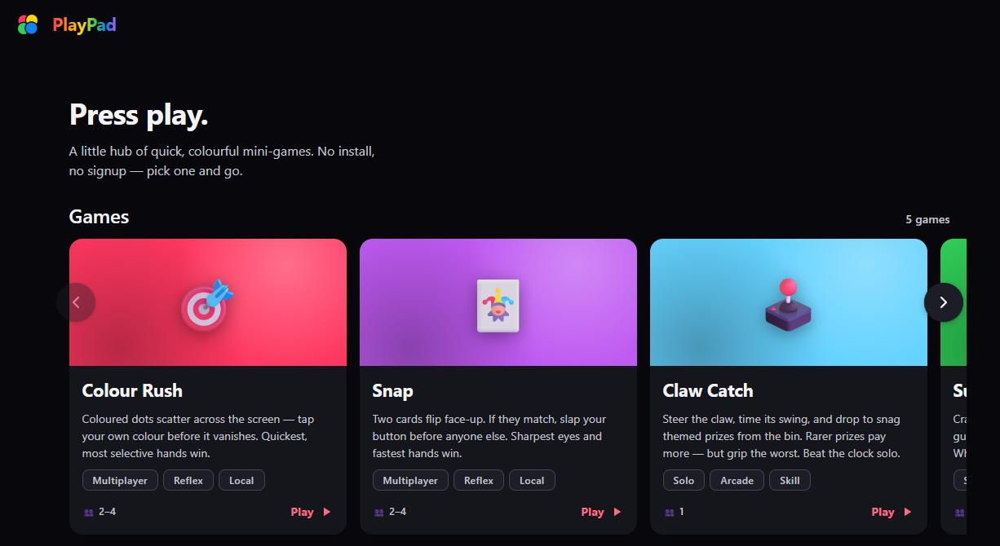

# PlayPad

> A colourful little hub of quick, playable browser mini-games.

**[▶ Play now at play-pad.pages.dev](https://play-pad.pages.dev)** · No install, no signup, no ads.



PlayPad is a static, build-free web hub that presents a growing catalogue of bite-size browser games behind one front door. It's styled with Material Design 3, works on desktop and mobile, and runs from the file system or any static host. There's no backend, and new games drop in with a one-object change.

## Games

| Game                                                                | Players | What it is                                                                             |
| ------------------------------------------------------------------- | ------- | -------------------------------------------------------------------------------------- |
| 🎯 [Colour Rush](https://play-pad.pages.dev/games/colour-rush/)     | 2–4     | Tap your own colour's dots before they vanish. Fastest, most accurate hands win.       |
| 🃏 [Snap](https://play-pad.pages.dev/games/snap/)                   | 2–4     | Two cards flip; if they match, slap your button first.                                 |
| 🕹️ [Claw Catch](https://play-pad.pages.dev/games/claw-catch/)       | 1       | Steer and time a swinging claw to grab prizes before the clock runs out.               |
| 🔐 [Super Decoder](https://play-pad.pages.dev/games/super-decoder/) | 1       | Crack a hidden 4-colour code in up to 10 guesses.                                      |
| 🌇 [Sunset Stride](https://play-pad.pages.dev/games/sunset-stride/) | 1       | A golden-hour 3D runner: swap lanes, jump, slide, outrun the dog pack, unlock outfits. |

## Run it locally

No build step. Either open `index.html` directly, or serve the folder:

```sh
python -m http.server 5500
# then open http://localhost:5500/
```

Sunset Stride's 3D models, photo textures and sound effects need the served version (browsers block them from `file://`); the game falls back to simple shapes, procedural textures and synth sound effects without them (the music still plays).

To run the checks CI runs (needs Node.js):

```sh
npm install
npm run check    # lint + formatting
npm run secrets  # secret scan
npx playwright install chromium  # once
npm run smoke    # opens the hub and every game, starts a round in each, fails on any error
```

## Add a game

1. Put the game in `games/<your-game>/index.html` (plain HTML/CSS/JS, no build step).
2. Add one entry to [`games.js`](games.js) — the hub renders its card automatically.
3. Open a pull request. CI must pass, and the maintainer reviews it.

See [CONTRIBUTING.md](CONTRIBUTING.md) for the full guide, and look for issues labelled [`good first issue`](https://github.com/BudGitH/play-pad/labels/good%20first%20issue) to get started.

## How this project works

The project keeps its knowledge in a small set of docs that any AI coding assistant reads automatically. Start at [CLAUDE.md](CLAUDE.md); it points to everything else. You don't need to read them to contribute.

- **What and why** → [`docs/PROJECT.md`](docs/PROJECT.md)
- **How it's built** → [`docs/ARCHITECTURE.md`](docs/ARCHITECTURE.md)
- **How we work** → [`docs/WORKFLOW.md`](docs/WORKFLOW.md)
- **How it should look** → [`docs/DESIGN-SYSTEM.md`](docs/DESIGN-SYSTEM.md)

Merging to `main` deploys the site automatically via Cloudflare Pages.

## Security

Please report vulnerabilities privately; see [SECURITY.md](SECURITY.md).

## Licence

Released under the [MIT License](LICENSE). Bundled third-party assets keep their own licences; see [`games/sunset-stride/assets/CREDITS.md`](games/sunset-stride/assets/CREDITS.md).
